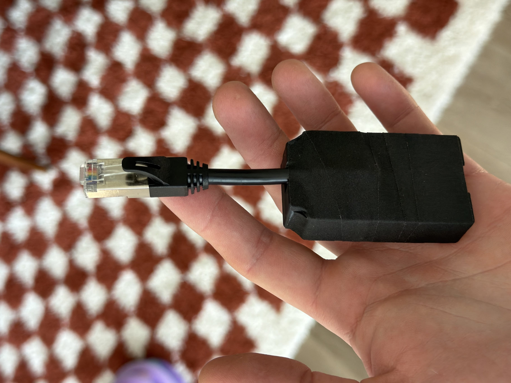

# Autonomous Desk Control for Home Assistant

I removed the factory handset from my SmartDesk 2 for a cleaner setup. This
fork puts all desk control in Home Assistant through the ESPHome API. The
original project keeps the factory keypad; my setup has no physical handset.

Use a Home Assistant dashboard, the mobile app, another control interface,
or Alexa configured through Home Assistant to move the desk.

My ESP32 bridge and the [cable I used](https://www.amazon.com/dp/B0B1ZK35WW).

## Setup

1. Copy [example.yml](example.yml) into your ESPHome configuration.
2. Add your Wi-Fi credentials, API encryption key, and OTA password to `secrets.yaml` using the names in the example.
3. Set the UART pins and height limits for your desk, then compile and upload using ESP-IDF.
4. Turn on **Motion Enabled** in Home Assistant. **Stop** turns it off again.

Tested with ESPHome 2026.7.2 on ESP32. Defaults: raw height 75-123, approximately
29.5-48.4 inches.

[Controls and API](docs/controls.md) · [Hardware and wiring](docs/wiring.md)

Forked from [Karan Sharma's autonomous-desk-esphome](https://github.com/at-karan-sharma/autonomous-desk-esphome).
[MIT license](LICENSE).
